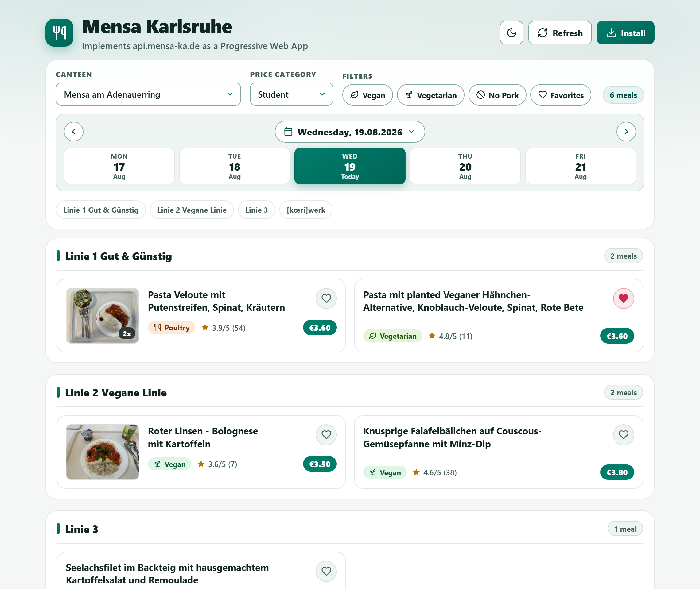
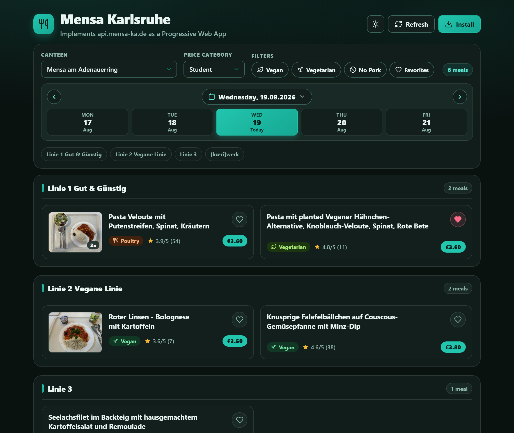

# Mensa Karlsruhe PWA & CORS Proxy

Cloudflare Worker serving the **Mensa Karlsruhe** Progressive Web App (`./web`) alongside an edge-cached GraphQL CORS proxy (`/api/`) for `https://api.mensa-ka.de/`, protected by **Cloudflare Access** and **ZITADEL**.

<p align="center">
  <picture>
    <source media="(prefers-color-scheme: dark)" srcset="assets/screenshot-dark.png" />
    <source media="(prefers-color-scheme: light)" srcset="assets/screenshot.png" />
    
  </picture>
</p>

<details>
  <summary>Preview both light and dark themes</summary>
  <p align="center">
    
    <br /><br />
    
  </p>
</details>

## Features

- **Modern Responsive UI**: Built with layered CSS, `light-dark()` theming (with system dark-mode fallback and zero-flash startup initialization), container-query meal cards (`@container meal-card`) that adapt horizontally only when photos exist, and semantic dietary badges (`Vegan`, `Vegetarian`, `Fish`, `Poultry`, `Beef`, `Pork`).
- **Fast Date & Line Navigation**: Interactive weekday strip and expandable 7-column month calendar (automatically skipping Saturdays and Sundays), quick line-jump pills (`#lineJumpNav`), and keyboard (`A` / `D`, `←` / `→`) or touch-swipe day switching.
- **Filtering, Favorites & Pricing**: Instant client-side toggles for `Vegan`, `Vegetarian`, `No pork`, and `Favorites` (saved in `localStorage`), price tier selector (`Student`, `Employee`, `Pupil`, `Guest`), and user ratings.
- **Native Top-Layer Photo Lightbox**: Accessible `<dialog>` gallery (`closedby="any"` with fallback click-outside handling, `@starting-style` and `[data-closing]` exit transitions), double-tap/double-click zoom, vertical swipe-to-dismiss, and keyboard image navigation.
- **Three-Tier Caching & Offline Resilience**:
  1. **Cloudflare Edge Cache** (`src/index.ts`): Caches GraphQL `POST /api/` responses per operation/date for 15 minutes (`900s`, reported via `X-Cache-Status`: `HIT`, `MISS`, or `BYPASS`). The UI's manual Refresh button sends `Cache-Control: no-cache`, `Pragma: no-cache`, `X-Refresh: true`, and `?refresh=1` to bypass stale edge entries.
  2. **Service Worker** (`web/sw.js`): Network-First shell cache (`mensa-ka-pwa-shell-v65`) for instant offline availability and updates, plus Cache-First meal image storage (`mensa-ka-pwa-images-v1`, trimmed to 120 photos).
  3. **Browser `localStorage` Fallback** (`web/app.js`): Retains per-day meal plans (`mensa-ka-pwa-cache:<date>`) as a fallback if both network and edge fail.
- **Cloudflare Access + ZITADEL Auth**: Verifies `cf-access-jwt-assertion` JWTs against ZITADEL-backed Cloudflare Access JWKS (`POLICY_AUD` and `TEAM_DOMAIN`) in production while automatically bypassing JWT validation for `localhost` and `127.0.0.1` in local development.

## Routes

| Route | Handler | Description |
| --- | --- | --- |
| `/` | Cloudflare Static Assets (`./web`) | Serves the Progressive Web App shell, manifest, icons, and service worker |
| `/api/`, `/api/*` | Worker (`src/index.ts`, `run_worker_first`) | Edge-cached GraphQL & GraphQL Playground CORS proxy for `api.mensa-ka.de` |

## Project Structure

```text
mensa-ka-pwa/
├── src/
│   └── index.ts                  # Cloudflare Worker CORS proxy, edge cache & Access JWT verifier
├── web/
│   ├── index.html                # PWA document shell, theme bootstrap & <dialog> lightbox
│   ├── styles.css                # Layered CSS, light/dark tokens, container queries & transitions
│   ├── app.js                    # GraphQL client, calendar/filters, favorites & lightbox logic
│   ├── sw.js                     # Service Worker (shell + 120-image offline cache)
│   ├── manifest.webmanifest      # Web App Manifest
│   └── assets/icons/             # App icons and iOS startup splash screens
├── test/
│   └── index.spec.ts             # Vitest + Cloudflare Workers pool unit tests
├── scripts/
│   ├── update-screenshot.mjs     # Headless light/dark screenshot generator for README
│   ├── install-hooks.mjs         # Configures git core.hooksPath -> .githooks
│   └── fixtures/                 # Deterministic dish thumbnails used for screenshots
├── .githooks/
│   └── pre-commit                # Auto-updates screenshots when staged files change in web/
├── .github/workflows/
│   └── update-screenshot.yml     # CI workflow keeping screenshots synced on push to main/master
├── assets/
│   ├── screenshot.png            # Light-mode README screenshot (auto-generated)
│   └── screenshot-dark.png       # Dark-mode README screenshot (auto-generated)
└── wrangler.jsonc                # Cloudflare Workers & static asset configuration
```

## Local Development & Testing

```powershell
# Install dependencies (also enables the .githooks pre-commit hook)
npm install

# Start the local Worker + static asset dev server
npm run dev
```

Open `http://localhost:8787`. Requests from `localhost` and `127.0.0.1` skip Cloudflare Access verification automatically. To test Access-backed requests locally, copy `.dev.vars.example` to `.dev.vars` and fill in `POLICY_AUD` and `TEAM_DOMAIN`.

Run tests and type checking:

```powershell
npm test
npx tsc --noEmit
```

## Automatic Screenshot Updates

Both [`assets/screenshot.png`](assets/screenshot.png) and [`assets/screenshot-dark.png`](assets/screenshot-dark.png) stay synchronized automatically with `./web` changes through three mechanisms:

1. **Manual Command (`npm run screenshot`)**: [`scripts/update-screenshot.mjs`](scripts/update-screenshot.mjs) launches an ephemeral local server serving `./web`, deterministic Wednesday menu/fixture data (`scripts/fixtures/dish-1.png`, `dish-2.png`), and captures both light and dark `1140×960` (`2x` DPR) PNG screenshots via headless Chrome or Microsoft Edge (set `CHROME_PATH` to override the executable path).
2. **Git Pre-Commit Hook (`.githooks/pre-commit`)**: Enabled automatically by `npm install` via `prepare` (`node scripts/install-hooks.mjs`, configuring `git config core.hooksPath .githooks`). Whenever you commit staged changes under `web/`, the hook regenerates and stages both screenshot PNGs.
3. **GitHub Actions (`.github/workflows/update-screenshot.yml`)**: On any push to `main` or `master` changing `web/**` or `scripts/update-screenshot.mjs`, CI regenerates the screenshots and commits any changes with `[skip ci]`.

## Deployment

Configure `POLICY_AUD` and `TEAM_DOMAIN` in `wrangler.jsonc` (or Cloudflare Worker variables/secrets), then deploy:

```powershell
npm run deploy
```
